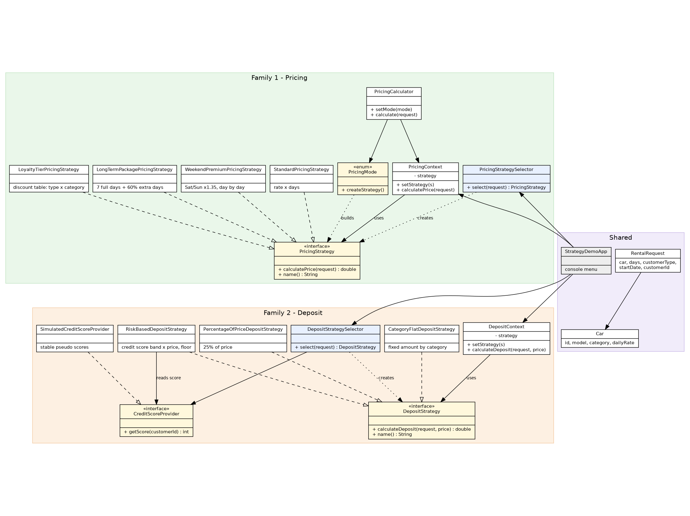

# Assignment 5 — Strategy Pattern (Car Rental)

**Student:** Utembayeva Karakat  
**Group:** SE-2535  
**Domain:** Car Rental (same variant as Assignment 4)  
**GitHub repository:** <https://github.com/YOUR-USERNAME/car-rental-strategy> *(replace YOUR-USERNAME with the real account)*

## 1. Overview

The Strategy pattern is applied to two families of algorithms in the Car Rental domain.

* **Pricing:** `StandardPricingStrategy`, `WeekendPremiumPricingStrategy`, `LongTermPackagePricingStrategy`, `LoyaltyTierPricingStrategy`.
* **Deposit:** `PercentageOfPriceDepositStrategy`, `CategoryFlatDepositStrategy`, `RiskBasedDepositStrategy`.

Each family has one interface, one context (constructor + `setStrategy()`, no `if`/`switch`) and one selector that picks a strategy automatically. `RiskBasedDepositStrategy` needs an external credit score, so it reads it only through the `CreditScoreProvider` interface. The demo uses a simulated source, the tests use a fake with fixed values. A new algorithm is a new class; no existing strategy or context changes.

## 2. Build, run

```bash
mvn clean test          # all unit tests
mvn exec:java           # interactive demo (menu 1-5; press Enter to accept a default)
```

Demo menu: 1 all pricing strategies · 2 all deposit strategies · 3 pricing manual vs Selector · 4 deposit manual vs Selector · 5 switch strategy at runtime.

## 3. Classes and responsibilities

**Pricing**

| Class | Responsibility |
|---|---|
| `PricingStrategy` | Declares the contract for calculating a rental price. |
| `StandardPricingStrategy` | Multiplies the daily rate by the number of rental days. |
| `WeekendPremiumPricingStrategy` | Charges 35 percent extra for every Saturday Sunday day in the rental. |
| `LongTermPackagePricingStrategy` | Charges the full rate for seven days, then 60 percent of the rate for each further day. |
| `LoyaltyTierPricingStrategy` | Looks up a discount by customer type, car category, then subtracts it from the base price. |
| `PricingContext` | Holds the current pricing strategy, lets callers replace it, delegates the calculation to it. |
| `PricingStrategySelector` | Picks a pricing strategy from customer type, rental length, start day. |
| `PricingMode` | Names each pricing algorithm, builds its strategy on request. |
| `PricingCalculator` | Keeps the mode-based entry point, delegates every calculation to a pricing context. |

**Deposit**

| Class | Responsibility |
|---|---|
| `DepositStrategy` | Declares the contract for calculating a security deposit. |
| `PercentageOfPriceDepositStrategy` | Sets the deposit to 25 percent of the rental price. |
| `CategoryFlatDepositStrategy` | Sets a fixed deposit looked up by car category. |
| `RiskBasedDepositStrategy` | Scales the deposit by the credit score read through the provider, with a category floor. |
| `CreditScoreProvider` | Hides the external credit data source behind one method. |
| `SimulatedCreditScoreProvider` | Returns a stable pseudo credit score derived from the customer id. |
| `DepositContext` | Holds the current deposit strategy, lets callers replace it, delegates the calculation to it. |
| `DepositStrategySelector` | Picks a deposit strategy from customer type, car category. |

**Shared and demo**

| Class | Responsibility |
|---|---|
| `Car` | Holds immutable vehicle data: id, model, category, daily rate. |
| `CustomerType` | Names the customer groups: regular, loyalty, corporate. |
| `RentalRequest` | Carries the input of one rental: car, days, customer type, start date, customer id. |
| `StrategyDemoApp` | Runs the console menu that shows all strategies, manual choice, automatic choice, runtime switching. |

## 4. Why Strategy, not State or Template Method

**State** describes an object whose behaviour changes with its own lifecycle, for example a reservation going NEW → RESERVED → CANCELLED. Domain events drive the transitions, and the client does not pick the state. Here the client, or the Selector, chooses an algorithm for the same operation (price, deposit) and can swap it at any moment. The context does not turn into something else.

**Template Method** fixes the skeleton of an algorithm in a base class, and subclasses override single steps. A new variant means a new subclass tied to that base class and chosen at compile time. In our pricing and deposit families the algorithms share no skeleton: weekend pricing walks day by day, the long-term package splits the days into two groups, the loyalty tier reads a table.

It is Strategy because several interchangeable algorithms solve the same problem, they are chosen and replaced at runtime, the context never branches on the strategy type, and adding an algorithm needs no change to existing classes (Open/Closed).

## 5. Refactoring with Git history

The pricing family was written the "bad" way first: all four variants in `PricingCalculator` with a `switch`. Then it was refactored into `PricingStrategy` + four implementations + `PricingContext`. `PricingBehaviorTest` is **the same file** on both commits and passes on both.

* **Before:** [`b8bd729`](https://github.com/YOUR-USERNAME/car-rental-strategy/commit/b8bd729) — before: monolithic pricing with switch
* **After:** [`f6a2325`](https://github.com/YOUR-USERNAME/car-rental-strategy/commit/f6a2325) — after: refactor pricing to Strategy

```bash
git checkout b8bd729 && mvn test     # switch version, behaviour tests pass
git checkout f6a2325  && mvn test     # Strategy version, same tests pass
git checkout main
```

## 6. UML class diagram



Vector version: `docs/uml-class-diagram.svg`, source: `docs/uml-class-diagram.dot`.
